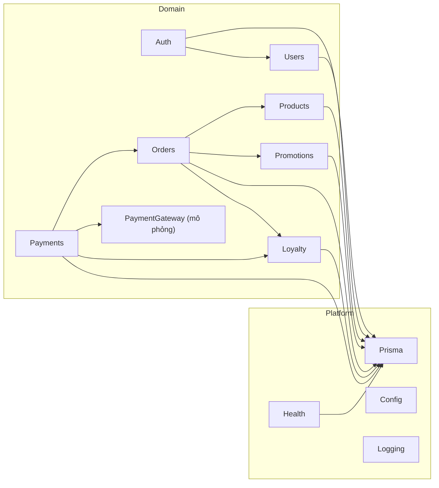

# Task 3.1 – Mô tả kiến trúc BrewLite

| Mục | Nội dung |
|---|---|
| Tài liệu | Assignment 2 – Task 3.1 |
| Phiên bản | 1.0 – 17/10/2026 |
| Phương pháp | **C4 model** (mức 1 Context, mức 2 Container, mức 3 Component cho API) kết hợp **kiến trúc phân lớp** bên trong từng container |
| Căn cứ | SRS (`docs/requirements/srs.md`), UC-01, Task 2 (`docs/diagrams/`), thiết kế Sprint 1 (`docs/sprint1/`) |
| Nguyên tắc | Thiết kế là nguồn chuẩn: code và hạ tầng được sửa theo tài liệu này; thay đổi kiến trúc phải qua ADR mới |
| Sơ đồ | `architecture-c4.puml` (Context và Container), `deployment-diagram.puml` (Task 3.2) |
| Quyết định | `adr/001` … `adr/010` (mục 12) |

---

## 1. Động lực kiến trúc

Các yêu cầu phi chức năng quyết định hình dạng hệ thống (xếp theo mức ảnh hưởng):

| Ưu tiên | Động lực | Yêu cầu | Hệ quả thiết kế |
|---|---|---|---|
| 1 | **Toàn vẹn dữ liệu khi đồng thời**: không bán quá kho, không trừ tiền hai lần | NFR-08, FR-18, FR-20 | Transaction, khóa lạc quan, `Idempotency-Key`, ràng buộc `CHECK` ở database |
| 2 | **Bảo mật**: giá do máy chủ quyết định, khách chỉ thấy đơn của mình, secret không lộ | NFR-04…NFR-07 | JWT, guard theo vai trò, DTO whitelist, cấu hình qua biến môi trường |
| 3 | **Khả năng triển khai**: một lệnh chạy local, CI/CD tự động, production qua HTTPS | NFR-13…NFR-17 | Docker, monorepo, pipeline, health check, migration |
| 4 | **Dùng tốt trên điện thoại**: mobile-first, đủ trạng thái tải/rỗng/lỗi | NFR-09, NFR-10 | Next.js, giao diện đáp ứng, PWA (mở rộng) |
| 5 | **Dễ kiểm thử và bảo trì** (nhóm sinh viên, thời gian một học kỳ) | NFR-18, NFR-19 | Kiến trúc đơn giản, module theo domain, logic nghiệp vụ là hàm thuần |

Ràng buộc: Next.js, NestJS, PostgreSQL, Docker là bắt buộc (C-01…C-04); nhóm nhỏ, ngân sách thấp (C-14, C-15).

## 2. Mức 1 – System Context

Sơ đồ: `architecture-c4.puml` (diagram `c4-context`).

| Thành phần | Loại | Vai trò |
|---|---|---|
| Khách hàng | Người dùng | Xem menu, đặt và thanh toán, theo dõi đơn, dùng điện thoại là chính |
| Nhân viên quầy | Người dùng | Nhận đơn đã thanh toán, cập nhật trạng thái |
| Quản lý | Người dùng | Quản trị cửa hàng (phạm vi mở rộng), kế thừa quyền nhân viên |
| **BrewLite** | Hệ thống đang xây | Toàn bộ nghiệp vụ đặt đồ uống |
| Cổng thanh toán (MoMo / VNPay) | Hệ thống ngoài, **mô phỏng** | Nhận yêu cầu thanh toán, trả thành công hoặc thất bại |

Tích hợp thật với cổng thanh toán nằm ngoài phạm vi (OS-1); giao diện `PaymentGateway` được thiết kế để thay bản mô phỏng bằng bản thật mà không đổi nghiệp vụ (ADR-005).

## 3. Mức 2 – Container

Sơ đồ: `architecture-c4.puml` (diagram `c4-container`).

```
Trình duyệt / PWA ──HTTPS──► Web App (Next.js) ┐
        │                                      │ (cùng một ứng dụng web,
        └──────────HTTPS (JSON, Bearer JWT)────┘  gọi API từ trình duyệt)
                              │
                              ▼
                     API (NestJS) ──Prisma, TCP 5432──► PostgreSQL
                       └─ PaymentGateway (mô phỏng, chạy cùng tiến trình)
```

| Container | Công nghệ | Trách nhiệm | Cổng | Mã nguồn | Triển khai |
|---|---|---|---|---|---|
| **Web App** | Next.js (App Router), TypeScript, Tailwind CSS, Zustand | Giao diện mobile-first/PWA; giỏ hàng; gọi API từ trình duyệt | 3000 | `apps/web` | Docker image `brewlite-web` |
| **API** | NestJS, TypeScript, Prisma | Toàn bộ nghiệp vụ, xác thực, validate, transaction, thanh toán mô phỏng | 4000 | `apps/api` | Docker image `brewlite-api` |
| **PostgreSQL** | PostgreSQL | Lưu dữ liệu; ràng buộc toàn vẹn; lịch sử migration | 5432 | `apps/api/prisma/` | Dịch vụ PostgreSQL có lưu trữ bền |
| Cổng thanh toán mô phỏng | Module trong API | Giả lập MoMo / VNPay | – | `apps/api/src/payments/gateway/` | **Không** là container riêng (ADR-005) |

Quy tắc giao tiếp:

1. Trình duyệt chỉ nói chuyện với Web App và API qua **HTTPS**; chỉ API được truy cập database.
2. Web App và API là hai origin khác nhau: API bật CORS cho đúng origin của Web App (`CORS_ORIGIN`).
3. Web App **không** chứa logic nghiệp vụ quyết định (giá, tồn kho, quyền); mọi quyết định ở API.
4. Database **không** public ra Internet; chỉ API kết nối qua mạng nội bộ của nền tảng.

## 4. Mức 3 – Component của API (NestJS theo module / domain)



| Module | Trách nhiệm | Endpoint chính | FR |
|---|---|---|---|
| `auth` | Đăng ký, đăng nhập, JWT, guard vai trò, `GET /auth/me` | `/auth/register`, `/auth/login`, `/auth/me`, `/auth/forgot-password` | FR-01…05 |
| `users` | Hồ sơ, số dư điểm | (nội bộ) | FR-15 |
| `products` | Menu, chi tiết, topping, tùy chọn, tồn kho | `GET /products`, `GET /products/:id` | FR-06…09 |
| `promotions` | Danh sách và kiểm tra mã khuyến mãi | `GET /promotions`, `POST /promotions/validate` | FR-10, 14 |
| `orders` | Tạo đơn, giữ kho, tính giá, hủy, lịch sử, đổi trạng thái | `POST /orders`, `GET /orders/me`, `GET /orders/:id`, `POST /orders/:id/cancel`, `PATCH /orders/:id/status` | FR-17, 18, 24…28 |
| `payments` | Thanh toán, idempotency, ghi kết quả | `POST /payments` | FR-19…23 |
| `loyalty` | Sổ điểm thưởng (EARN, REDEEM, REFUND, REVOKE) | (nội bộ) | FR-15, 22, 26 |
| `payments/gateway` | `PaymentGateway` và bản mô phỏng | (nội bộ) | FR-19 |
| `prisma` | Kết nối database, hỗ trợ transaction | – | – |
| `config` | Đọc và kiểm tra biến môi trường khi khởi động | – | NFR-07, 17 |
| `common` | Logging, lọc lỗi, hằng số, hàm tính giá | – | NFR-05 |
| `health` | `GET /health` | `/health` | NFR-17 |

### Phân lớp trong mỗi module

```
Controller   nhận request, kiểm tra JWT/vai trò, validate DTO, gọi Service, trả DTO
   │
Service      nghiệp vụ, mở transaction, điều phối giữa module (qua Service được export)
   │
Domain logic hàm thuần, không I/O: tính giá, state machine đơn, tính giảm giá, tính điểm
   │
Prisma       truy cập dữ liệu (chỉ Service gọi)
```

Quy tắc:

| # | Quy tắc | Lý do |
|---|---|---|
| 1 | Module chỉ gọi module khác qua **Service được export**, không đọc bảng của module khác bằng Prisma trực tiếp, **trừ** khi tham gia cùng một transaction do `orders` hoặc `payments` điều phối | Giữ ranh giới domain |
| 2 | Không trả entity Prisma ra ngoài, luôn qua DTO | Không lộ `stock`, `version`, `passwordHash`… |
| 3 | Logic tính giá, giảm giá, điểm, state machine là **hàm thuần** | Unit test nhanh, không cần database (NFR-18) |
| 4 | Gọi cổng thanh toán **nằm ngoài** transaction database | Không giữ khóa DB trong lúc chờ mạng |
| 5 | Mọi thay đổi nhiều bảng (đặt đơn, hủy đơn, ghi kết quả thanh toán) nằm trong **một transaction** | NFR-08 |

### Điểm quyết định kỹ thuật quan trọng

| Vấn đề | Thiết kế | ADR |
|---|---|---|
| Không bán quá kho | Cột `version` trên `Product`; cập nhật có điều kiện `WHERE version = ?`; thử lại có giới hạn; thất bại trả 409 | 007 |
| Chuyển trạng thái đơn đúng thứ tự | State machine thuần + `version` trên `Order` | 007 |
| Không thanh toán hai lần | `Idempotency-Key` bắt buộc, `UNIQUE` ở bảng `Payment`; gửi lại trả kết quả cũ | 005 |
| Giá do máy chủ quyết định | Client chỉ gửi `productId`, tùy chọn, số lượng; máy chủ tính lại từ database | 003, 005 |
| Thứ tự khóa khi giữ kho nhiều sản phẩm | Duyệt sản phẩm theo `id` tăng dần | 007 |

## 5. Kiến trúc Web App (Next.js)

| Hạng mục | Thiết kế |
|---|---|
| Khung | Next.js App Router, TypeScript strict |
| Giao diện | Tailwind CSS, mobile-first, token màu ở `03-mvp-design.md` mục 6.6 |
| Route | `/menu`, `/menu/[id]`, `/cart`, `/checkout`, `/login`, `/register`, `/orders`, `/orders/[id]`, `/orders/[id]/success`, `/orders/[id]/failed` |
| Lấy dữ liệu | Component client + hook (`useProducts`…) gọi `lib/api.ts`; không cần SSR vì không có yêu cầu SEO |
| Trạng thái | **Zustand**: `cart` (lưu `localStorage`), `auth` (JWT và hồ sơ) |
| Bảo vệ route | Hook `useRequireAuth` chuyển tới `/login` khi chưa đăng nhập |
| Lỗi | `ApiError { status, message }`; giao diện luôn có 3 trạng thái tải, rỗng, lỗi |
| PWA | Sprint 1: chưa có. Mở rộng: `manifest.webmanifest`, biểu tượng, service worker chỉ cache **tài nguyên tĩnh**, **không cache phản hồi API** (giá và tồn kho phải mới) |
| Idempotency | Mỗi lần xác nhận thanh toán sinh `Idempotency-Key` mới bằng `crypto.randomUUID()`; thử lại cùng một yêu cầu dùng lại key đó |
| Cấu hình | Chỉ `NEXT_PUBLIC_API_URL` (không chứa secret) |

## 6. Dữ liệu và migration

| Hạng mục | Thiết kế |
|---|---|
| CSDL | PostgreSQL; mô hình theo `docs/diagrams/class-domain.puml` |
| ORM | Prisma |
| Migration | `prisma migrate` (dev) và `prisma migrate deploy` (production); thư mục `prisma/migrations` **được commit**; không dùng `db push` ngoài thử nghiệm cá nhân |
| Ràng buộc | `CHECK (price >= 0)`, `CHECK (stock >= 0)`, `UNIQUE` cho email, `Payment.idempotencyKey`, `Promotion.code`, `Product.name` |
| Thay đổi schema an toàn | Quy tắc **mở rộng rồi thu gọn** (expand/contract): thêm cột/bảng trước, chạy code mới, xóa cột cũ ở lần phát hành sau; migration không được làm phiên bản đang chạy lỗi |
| Seed | `prisma/seed.ts`, dùng `upsert`, chạy lặp lại được; chỉ dùng cho local, CI và demo |
| Tiền tệ | Số nguyên VND, không dùng số thực |
| Sao lưu | Dùng sao lưu của nền tảng; seed là bản dự phòng cho dữ liệu demo |

## 7. Thanh toán mô phỏng

```
PaymentsService ──► PaymentGateway (interface)
                         ├── MockPaymentGateway   (hiện thực ở MVP; provider MoMo / VNPay giả lập)
                         └── (tương lai) hiện thực thật
```

| Hạng mục | Thiết kế |
|---|---|
| Giao diện | `charge({ orderId, amount, method })` trả `{ ok, transactionId }` hoặc `{ ok: false, reason }` |
| Ánh xạ | `WALLET` → provider MoMo; `CARD` → provider VNPay |
| Độ trễ giả lập | Mặc định 400 ms (`PAYMENT_MOCK_DELAY_MS`) |
| Kết quả giả lập | `PAYMENT_MOCK_MODE` = `random` (tỉ lệ thất bại `PAYMENT_MOCK_FAIL_RATE`), `success` hoặc `fail`, để demo cả hai nhánh |
| Số tiền | Luôn lấy từ `Order.total` trong database |
| Lỗi cổng | Ngoại lệ hoặc hết thời gian chờ được xem như thất bại |
| Biến môi trường mới | `PAYMENT_MOCK_MODE`, `PAYMENT_MOCK_FAIL_RATE`, `PAYMENT_MOCK_DELAY_MS` (bổ sung vào `.env.example` ở Sprint 2) |

## 8. Các mối quan tâm xuyên suốt

| Hạng mục | Thiết kế |
|---|---|
| **Cấu hình** | `@nestjs/config`; kiểm tra schema biến môi trường khi khởi động, thiếu hoặc sai thì **dừng ngay** (fail fast); không có giá trị mặc định cho secret; `.env.example` liệt kê đủ biến |
| **Logging** | Mỗi request một dòng log có `requestId`, method, đường dẫn, mã trạng thái, thời gian (ms); định dạng JSON ở production; ghi ra `stdout` để nền tảng thu thập; **không** ghi `Authorization`, mật khẩu, JWT, số thẻ; mức log chỉnh bằng `LOG_LEVEL` |
| **Health check** | `GET /health`: 200 khi ứng dụng và database ổn, 503 khi database lỗi; dùng cho Docker healthcheck, nền tảng và smoke test |
| **Xử lý lỗi** | Định dạng chung `{ statusCode, message, error }`; thông báo tiếng Việt; không lộ stack trace hay chi tiết database |
| **Validate** | `ValidationPipe` (`whitelist`, `forbidNonWhitelisted`, `transform`) ở API; kiểm tra sơ bộ ở frontend để phản hồi nhanh, API vẫn là chốt chặn |
| **Xác thực** | JWT Bearer, mật khẩu băm bcrypt, guard theo vai trò (`CUSTOMER`, `STAFF`, `MANAGER`) |
| **Bảo vệ lạm dụng** | Giới hạn tần suất (rate limit) cho `/auth/*` và `/payments`; header bảo mật (helmet); CORS đúng origin |
| **Secret** | Chỉ trong biến môi trường của nền tảng và GitHub Secrets; `.env` không commit; không in ra log CI |
| **Phiên bản** | Semantic Versioning; image gắn commit SHA hoặc `vX.Y.Z` |

## 9. Thuộc tính chất lượng và cách đáp ứng

| NFR | Cách đáp ứng trong kiến trúc | Kiểm chứng |
|---|---|---|
| NFR-01, 02, 03 (hiệu năng) | Truy vấn đơn giản có chỉ mục `(isActive, category)`; không cache dữ liệu giá/tồn; ảnh nhỏ gọn; cổng mô phỏng 400 ms | Đo p95 local (AC-N01.1) |
| NFR-04, 05, 06 (bảo mật) | JWT + bcrypt, DTO whitelist, giá tính ở máy chủ, kiểm tra sở hữu đơn, guard vai trò | Integration test 401/403/404 |
| NFR-07 (secret, HTTPS) | Biến môi trường, GitHub Secrets, TLS ở nền tảng | Rà soát lịch sử Git và log CI |
| NFR-08 (toàn vẹn) | Transaction, khóa lạc quan, `CHECK`, `UNIQUE`, idempotency | Test đồng thời (AC-N08.1) |
| NFR-09, 10 (khả dụng, PWA) | Next.js mobile-first, 3 trạng thái, PWA mở rộng | Kiểm tra 360 px, Lighthouse |
| NFR-13…16 (triển khai) | Docker Compose, Dockerfile, CI/CD, migration có kiểm soát | Chạy README từ máy sạch |
| NFR-17 (vận hành) | `/health`, log JSON, cấu hình qua môi trường | Smoke test sau deploy |
| NFR-18, 19 (kiểm thử, bảo trì) | Logic thuần, module theo domain, ma trận truy vết | `npm test`, `traceability-matrix.md` |

## 10. Lý do chọn, ưu điểm, hạn chế và đánh đổi

**Kiến trúc được chọn:** *modular monolith* (một API NestJS chia module theo domain) + một web app Next.js + một PostgreSQL, trong một monorepo.

| Lựa chọn | Ưu điểm | Hạn chế | Đánh đổi chấp nhận |
|---|---|---|---|
| **Modular monolith** thay vì microservices | Một lần triển khai; transaction đơn giản giữa đơn, kho, điểm; ít hạ tầng, hợp nhóm nhỏ | Mở rộng theo từng module khó hơn; một lỗi nặng có thể ảnh hưởng toàn API | Quy mô quán cà phê không cần tách dịch vụ; ranh giới module giữ đường lui |
| **Monorepo** | Một PR sửa cả API và web; chia sẻ tài liệu và CI | CI có thể chạy nhiều hơn cần thiết | Tách job `api`, `web` trong CI |
| **Client-side fetching** thay vì SSR | Đơn giản, dễ test, không cần SEO | Lần tải đầu hiện khung rồi mới có dữ liệu | Có skeleton; ứng dụng đặt hàng không cần SEO |
| **Khóa lạc quan** thay vì khóa bi quan | Không giữ khóa dòng khi tải cao; đơn giản | Có thể phải thử lại; có thể thất bại 409 khi tranh chấp cao | Tranh chấp thấp ở quy mô quán; thử lại có giới hạn |
| **Cổng thanh toán mô phỏng trong tiến trình API** | Không thêm container; dễ demo | Không phản ánh độ trễ và lỗi mạng thật | Giao diện `PaymentGateway` cho phép thay thế |
| **JWT Bearer lưu ở trình duyệt** | Đơn giản, hai origin riêng không vướng cookie chéo miền | Rủi ro XSS đọc được token | Hạn dùng ngắn, header bảo mật, không render HTML thô (ADR-006) |
| **Prisma + migrate** | Kiểu an toàn, migration có lịch sử | Một số ràng buộc phải viết SQL tay trong migration | Ghi `CHECK` trong file migration SQL |
| **Nền tảng PaaS** (ADR-008) | Triển khai nhanh, có HTTPS và log sẵn | Gói miễn phí có giới hạn (ngủ đông, database hết hạn) | Xem rủi ro AR-01, AR-02 |

## 11. Rủi ro kiến trúc

| ID | Rủi ro | Giảm thiểu |
|---|---|---|
| AR-01 | Gói miễn phí: dịch vụ ngủ sau khoảng 15 phút, khởi động lại mất khoảng 1 phút | Làm nóng trước giờ chấm và demo; nâng lên gói rẻ nhất cho API trong thời gian chấm; smoke test có chờ |
| AR-02 | Database miễn phí hết hạn sau một thời gian cố định (khoảng 30 ngày, kiểm tra lại trang giá) | Ghi ngày tạo; có `seed` để dựng lại; nâng gói hoặc tạo lại trước ngày chấm |
| AR-03 | Hai origin gây lỗi CORS | Kiểm thử CORS ở CI smoke test; `CORS_ORIGIN` là biến bắt buộc |
| AR-04 | Migration lỗi làm deploy hỏng | Expand/contract; chạy migration một lần khi khởi động; nền tảng giữ phiên bản cũ khi health check thất bại (ADR-009) |
| AR-05 | Token bị đánh cắp qua XSS | Header bảo mật, không dùng `dangerouslySetInnerHTML`, hạn dùng JWT ngắn |
| AR-06 | Tranh chấp tồn kho cao khiến nhiều lần 409 | Giới hạn thử lại, thông báo thân thiện, theo dõi tỉ lệ 409 trong log |

## 12. Danh mục ADR

| ADR | Quyết định | Trạng thái |
|---|---|---|
| [001](adr/001-monorepo.md) | Monorepo với npm workspaces | Chấp nhận |
| [002](adr/002-nextjs-pwa-frontend.md) | Next.js App Router, client-side fetching, PWA theo giai đoạn | Chấp nhận |
| [003](adr/003-nestjs-modular-backend.md) | NestJS modular monolith theo domain | Chấp nhận |
| [004](adr/004-postgresql-prisma-migration.md) | PostgreSQL, Prisma, migration có kiểm soát | Chấp nhận |
| [005](adr/005-mock-payment-idempotency.md) | Cổng thanh toán mô phỏng và Idempotency-Key | Chấp nhận |
| [006](adr/006-jwt-authentication.md) | JWT Bearer và phân quyền theo vai trò | Chấp nhận |
| [007](adr/007-optimistic-locking-inventory.md) | Khóa lạc quan cho tồn kho và trạng thái đơn | Chấp nhận |
| [008](adr/008-deployment-platform.md) | Nền tảng triển khai (đề xuất Render, Singapore) | **Đề xuất – chờ nhóm xác nhận** |
| [009](adr/009-ci-cd-github-actions-ghcr.md) | CI/CD bằng GitHub Actions, image trên GHCR, migration và rollback | Chấp nhận |
| [010](adr/010-identifier-strategy.md) | Chiến lược mã định danh (UUID cho catalog, int cho còn lại) | Chấp nhận |

## 13. Truy vết thành phần kiến trúc

Mỗi container, dịch vụ và node trong `deployment-diagram.puml` truy được tới một thành phần trong tài liệu này và tới mã nguồn.

| Thành phần trên deployment diagram | Thành phần kiến trúc (mục) | Mã nguồn / cấu hình | ADR | Sprint |
|---|---|---|---|---|
| Thiết bị người dùng, Trình duyệt / PWA | Mức 1 Context (mục 2); Web App (mục 5) | `apps/web/public/` (manifest, mở rộng) | 002 | 1–2 |
| Web Service `brewlite-web` | Container Web App (mục 3, 5) | `apps/web`, `apps/web/Dockerfile` | 001, 002 | 1–2 |
| Web Service `brewlite-api` | Container API (mục 3, 4) | `apps/api`, `apps/api/Dockerfile` | 003 | 1–2 |
| `MockPaymentGateway` trong API | Mục 7 | `apps/api/src/payments/gateway/` | 005 | 2 |
| PostgreSQL có lưu trữ bền | Container PostgreSQL, mục 6 | `apps/api/prisma/schema.prisma`, `migrations/`, `seed.ts` | 004 | 1 |
| Endpoint `/health` và health check | Mục 8 | `apps/api/src/health/` | 003 | 1 |
| Cấu hình, secret, biến môi trường | Mục 8 | `.env.example`, `apps/api/src/config/` | 003, 009 | 1 |
| Log (stdout) | Mục 8 | `apps/api/src/common/logging.interceptor.ts` | 003 | 1 |
| Registry (GHCR) | Mục 12 (ADR-009) | `.github/workflows/cd.yml` | 009 | 2 |
| GitHub Actions (CI) | `docs/sprint1/04-ci-design.md` | `.github/workflows/ci.yml` | 009 | 1 |
| GitHub Actions (CD) | ADR-009 | `.github/workflows/cd.yml` | 009 | 2 |
| Nền tảng triển khai (Render) | ADR-008 | cấu hình dịch vụ; `docs/deployment.md` | 008 | 2 |
| Máy lập trình viên với Docker Compose | Mục 3 | `docker-compose.yml`, `package.json` | 001, 004 | 1–2 |
